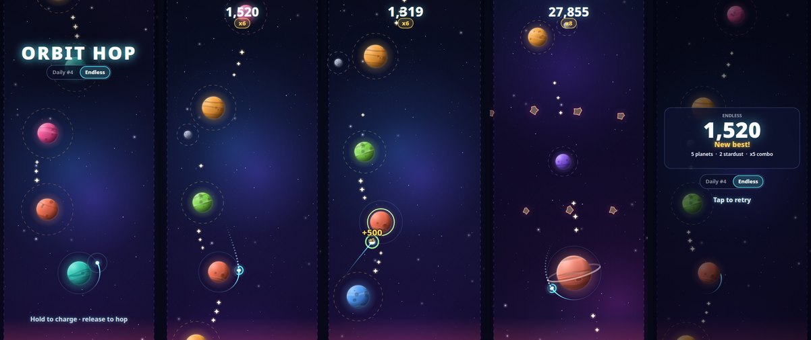

# Orbit Hop

**Hold, aim, let go.** Orbit Hop is a one-thumb gravity-slingshot arcade game built for
[YouTube Playables](https://developers.google.com/youtube/gaming/playables). You pilot a small
glowing probe from one planet's orbit to the next. Hold to charge, watch the dotted trajectory
bend around the gravity wells, and release to hop. Chain quick hops for combo multipliers, skim
surfaces for near-miss bonuses, scoop stardust off ambitious arcs, and slingshot through black
hole rings, while the column of planets climbs forever.



Every pixel and every sound is generated at runtime: no image, font or audio files. The whole
game is **~57 KiB (~21 KiB gzipped)** in two files.

## Controls

| Action | Touch | Mouse | Keyboard |
|---|---|---|---|
| Charge a hop (the preview shows the first 0.6 s) | hold | hold left button | hold Space / Enter / ↑ / W |
| Launch | release | release | release |
| Switch Daily / Endless (title and game over) | tap the chip | click the chip | ← → or M |
| Retry | tap | click | Space / Enter |
| Continue after a pause | tap | click | Space / Enter / Esc |

## What's in it

- **Core loop.** Orbit, charge, release tangentially, get captured by the next planet's zone.
  Capturing gives a short time-dilation, a ring burst, light screen shake, and a pentatonic chime
  that climbs with your combo.
- **Scoring.** +100 per capture × combo (x2 … x8 for hops that land within 2 s of the previous capture, orbit time included),
  +25 near miss, +10 stardust, +250 for surviving a black hole's slingshot ring.
- **Variety, unlocked by distance.** Plain planets, then moons (moving targets), gas giants,
  asteroid belts, pulsars (a capture zone that opens and closes) and black holes (no capture,
  strong pull).
- **Modes.** *Daily #N* is seeded by the UTC date and the same for everyone. Your first attempt
  is scored and later ones are practice. *Endless* uses a random seed and chases your best.
- **Feel.** A fixed 120 Hz deterministic sim with interpolated rendering. Input edges are queued,
  so even a sub-frame tap registers. Death breaks the probe into shards, and the restart is one
  tap with no menus.

## Run it

```sh
npm install
npm run dev            # local dev server (http://127.0.0.1:5173)
npm test               # vitest: sim determinism, reachability, save schema, adapter fallback
npm run bot            # headless difficulty bot: first-death distribution and gap reachability
npm run check:bundle   # production build plus the Playables bundle checks
npm run shots          # Playwright screenshots at 4 sizes, plus prod and Playables smoke tests
npm run package        # check:bundle, then orbit-hop-playable.zip (dist/ at the zip root)
```

`npm run shots` needs Playwright's Chromium (`npx playwright install chromium`). It writes
`shots/` (gitignored).

Dev-only URL flags (dev server only, never in the build): `?seed=42`, `?mode=daily`,
`?autoplay`, `?t=12` (fast-forward), `?shot=title|charge|flight|capture|over|pause`,
`?lang=de`.

## Playables integration

Every SDK call goes through [`src/platform/yt.ts`](src/platform/yt.ts), which also works outside
YouTube (local dev, the GitHub Pages demo).

| SDK | Use |
|---|---|
| `<script src="https://www.youtube.com/game_api/v1">` | First script in `index.html`, never bundled |
| `game.firstFrameReady()` | After the splash frame is drawn |
| `game.gameReady()` | Once the title (the interactive "hold to play" state) is up |
| `game.loadData()` / `saveData()` | Loaded once at boot. Every save is chained after the load. Small versioned JSON (< 2 KB) with migration from empty, corrupt or older saves |
| `engagement.sendScore()` | Each scored run's integer score. The saved best is always the max of what was sent |
| `system.getLanguage()` | en / de / fr / it / es, falling back to English |
| `system.isAudioEnabled()` / `onAudioEnabledChange()` | Silent whenever YouTube audio is off |
| `system.onPause()` / `onResume()` | Freezes the loop, sim, audio and rendering, and saves. Resume shows "tap to continue" |
| `ads.requestInterstitialAd()` | Hook only, off in v1 (`ADS_ENABLED = false`) |
| `health.logError()` | On uncaught errors |

Outside Playables the adapter uses localStorage for saves, the browser language, and
`visibilitychange` for pause. Inside Playables it uses none of these, as certification requires.
Requirement-by-requirement status, with how each one was verified, is in
[`docs/CERTIFICATION.md`](docs/CERTIFICATION.md).

## Bundle

```
assets/game-<hash>.js   ~55 KiB   ~20 KiB gzipped
index.html              ~1 KiB    ~0.6 KiB gzipped
total                   ~57 KiB   ~21 KiB gzipped (2 files)
```

`npm run check:bundle` fails the build if any file is over 512 KiB, the gzipped total is over
1 MB, a file name has characters outside `[A-Za-z0-9_.-]`, an absolute URL or path appears
(other than the SDK), the SDK isn't the first script, or `Worker`, `WebAssembly`, `eval(`,
`new Function`, a network API or dev-only code shows up in the output.

## Layout

```
src/sim/        deterministic headless simulation, world generator, search bots (no DOM)
src/render/     Canvas 2D renderer, procedural sprites, starfield, particles, camera, UI
src/audio/      procedural WebAudio synth
src/platform/   yt.ts adapter, input, save schema, i18n
src/main.ts     boot and the state machine (title → playing → game over → playing)
src/dev.ts      dev-only URL flags (excluded from production builds)
scripts/        bot, bundle checks, screenshots, packaging
docs/           SPEC.md, CERTIFICATION.md, APPLICATION.md
```

## Demo

`.github/workflows/pages.yml` builds and deploys `dist/` to GitHub Pages on every push to `main`.
GitHub Pages only serves it once the repository is public, and that's Nikola's call.
